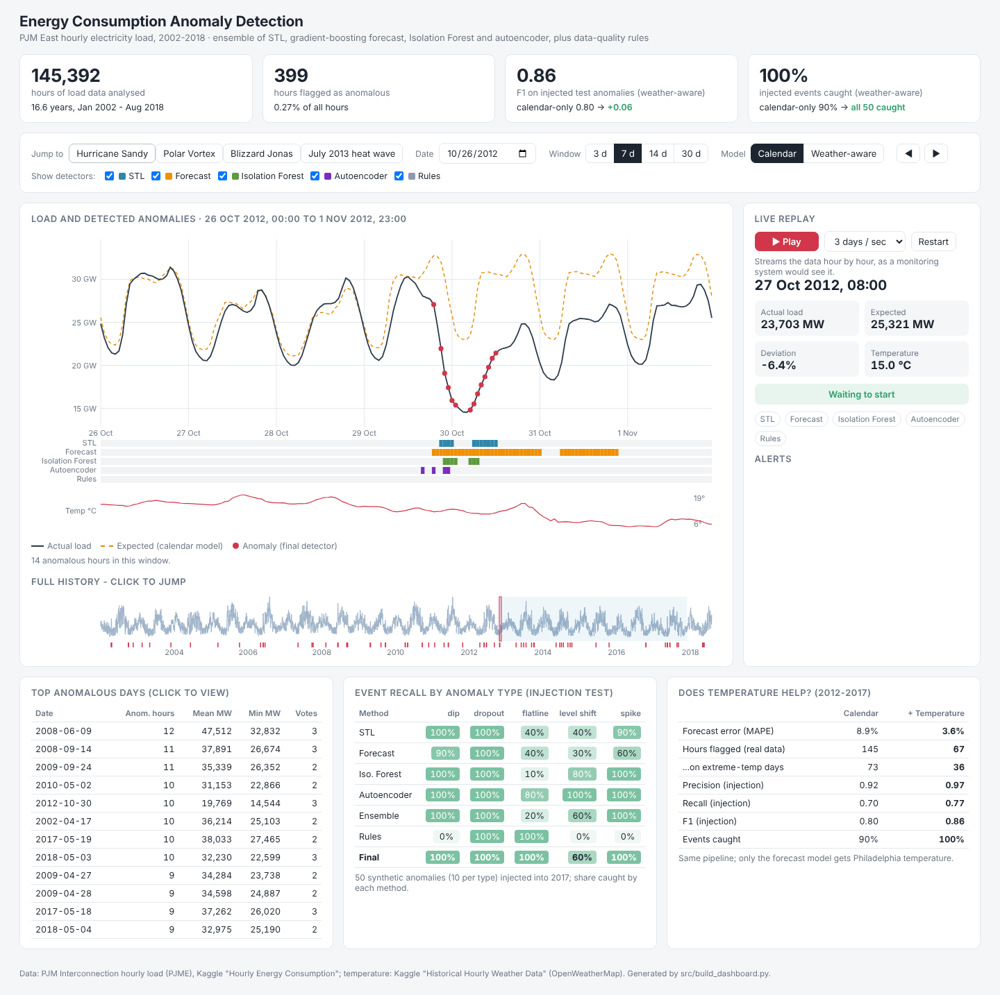

# Energy Consumption Anomaly Detection

**M.E. Artificial Intelligence project, Thapar Institute of Engineering and Technology (TIET), Patiala**

| Team member | Roll number |
|---|---|
| Kumar Uttchrist Sinha | 8026430015 |
| Mahir Vashisht | 8026340018 |

**GitHub:** https://github.com/ksinhame26-arch/energy-consumption-anomaly-detection



Unsupervised detection of anomalies in hourly electricity load for the PJM East region
(US grid operator), 2002–2018, 145,392 hourly readings.

## Dataset
- **File:** `data/raw/PJME_hourly.csv` (columns `Datetime`, `PJME_MW`)
- **Source:** PJM Interconnection hourly load. This is the public "Hourly Energy Consumption" dataset
  (Kaggle, Rob Mulla), downloaded from a GitHub mirror.
- **Cleaning:** 4 duplicate timestamps (daylight-saving changeovers) were averaged, and 30 missing
  hours were time-interpolated (longest gap: 1 hour). The clean series is in `data/processed/pjme_clean.csv`.

## Approach
Four detectors work on different views of the data. A vote combines them, and rule checks cover
data-quality faults.

| # | Method | Idea | Granularity |
|---|--------|------|-------------|
| 1 | **STL + robust z-score** | Decompose load (weekly period, 168h) and score residuals with a rolling median/MAD z-score (abs z > 4) | hour |
| 2 | **Forecast residual (Gradient Boosting)** | Predict "calendar-normal" load from hour, weekday, season, holidays and year, out-of-sample (folds grouped by year); score residuals with robust z (abs z > 4) | hour |
| 3 | **Isolation Forest** | Multivariate outliers on load, cyclical time features, 1h/24h/168h changes and short-term volatility (contamination 1%) | hour |
| 4 | **Autoencoder (MLP 24-32-8-32-24)** | Learns normal 24-hour load shapes. Days with high reconstruction error are flagged (robust z > 3.5), then the worst hours in those days | day, localized to hours |
| 5 | **Ensemble** | Hour is anomalous if at least 2 of the 4 detectors agree | hour |
| 6 | **Data-quality rules** | Stuck meter (4 or more identical consecutive readings) or near-zero reading (under 5% of the 30-day median) | hour |
| **Final** | **Ensemble OR rules** | | hour |

The rolling robust z-score (median/MAD over 30 days) lets thresholds adapt across seasons: a
2,000 MW deviation means more in a mild April night than on a July afternoon.

## Evaluation
The real data has **no anomaly labels**, so the project uses two kinds of checks:

**1. Synthetic injection (quantitative).** 50 anomalies were injected into 2017, 10 of each type:
spike, dip, level shift (6–24h), flatline/stuck meter (12–48h) and dropout (2–6h). All detectors
were then re-run on the modified series. An event counts as detected if any flag falls inside it (±2h).

| Method | Point precision | Point recall | Point F1 | Event recall |
|--------|---:|---:|---:|---:|
| STL + robust z | 0.57 | 0.24 | 0.34 | 0.74 |
| Forecast residual (GBM) | 0.61 | 0.24 | 0.35 | 0.64 |
| Isolation Forest | 0.44 | 0.21 | 0.28 | 0.78 |
| Autoencoder | 0.69 | 0.14 | 0.24 | 0.96 |
| Ensemble (2 or more votes) | 0.65 | 0.21 | 0.32 | 0.76 |
| Data-quality rules | 1.00 | 0.62 | 0.77 | 0.40 |
| **Final (ensemble OR rules)** | **0.87** | **0.73** | **0.79** | **0.92** |

Event recall by type is in `outputs/evaluation_by_type.csv` and `figures/07_method_comparison.png`.
Spikes, dips and dropouts are caught 100% of the time. Flatlines are almost invisible to the
statistical models (a frozen value looks "normal"), which is why the rule layer is needed. The rules
raise **zero** flags on the real data, so they add recall without false alarms. Level shifts are the
hardest remaining case (60%). The autoencoder alone catches them all, so a weighted vote is a
natural next step.

*Note:* point precision is a lower bound, because genuine anomalies already present in 2017 count
as false positives.

**2. Known real events (qualitative).** Hurricane Sandy (29–30 Oct 2012) produced the lowest load
in the whole dataset (14,544 MW at 04:00 on 30 Oct, 37% below expected; up to 42% below in the worst flagged hour). All four detectors fire on it
(`figures/05_event_hurricane_sandy.png`). One honest gap: the three deepest hours (02:00-04:00 on
30 Oct) get only one vote. The forecast model is very sure (z of about -7.5), but STL sits just under
its threshold (z = -3.6 against 4), so the 2-vote ensemble leaves them out while flagging the hours
around them. A rule letting a single detector win when it is extremely confident would close this
gap. Weather extremes such as the January 2014 polar vortex are
mostly *not* flagged. That's the right call: the weather experiment below shows this demand is
explained by temperature.

## Weather experiment: does temperature help?
`src/run_weather_experiment.py` adds hourly **Philadelphia temperature** (Kaggle "Historical
Hourly Weather Data", OpenWeatherMap) to the forecast model. Timestamps were converted from UTC to
US Eastern time; this was verified because the coolest summer hour falls at 06:00 local. Five
features were added: current temperature, 24h and 72h rolling means, and the day's min and max.
The weather data covers **Oct 2012 to Nov 2017**, so both versions are compared on that period
(45,251 hours). Everything except the forecast model is identical.

Load against temperature is U-shaped: load is lowest around 12-16 °C, rising with heating demand
below that and cooling demand above about 20 °C (`outputs/weather_experiment/figures/w1_load_vs_temperature.png`).

| | Calendar only | Calendar + temperature |
|---|---:|---:|
| Forecast error (MAPE) | 8.9% | **3.6%** |
| Forecast error (RMSE) | 4,005 MW | **1,571 MW** |
| Hours flagged on real data (final detector) | 145 | **67** |
| ...of which on extreme-temperature days (5% coldest/hottest) | 73 | **36** |
| Hurricane Sandy hours flagged | 12 | 12 |
| **Injection benchmark (2017), final detector** | | |
| Precision | 0.92 | **0.97** |
| Recall | 0.70 | **0.77** |
| F1 | 0.80 | **0.86** |
| Event recall | 0.90 | **1.00** |
| Level-shift event recall | 0.50 | **1.00** |

**Conclusion:** temperature cuts forecast error by 60% and halves false alarms on extreme-weather
days, while the real anomaly (Sandy) is still caught. All 50 injected events are now detected. The
forecast detector alone improves the most (F1 from 0.32 to 0.83), because its "expected" line now
follows heat waves and cold snaps instead of treating them as anomalies
(`outputs/weather_experiment/figures/w3_polar_vortex.png`).

## Results on real data
- 399 anomalous hours flagged (0.27% of all hours) by the final detector
- Top anomalous days: `outputs/top_anomalous_days.csv`
- Full hourly output with every score and flag: `outputs/anomalies_hourly.csv`

## Project structure
```
data/raw/                PJME_hourly.csv, historical_hourly_temperature.csv (inputs)
data/processed/          pjme_clean.csv
src/data_prep.py         loading, cleaning, feature engineering
src/detectors.py         the 4 detectors, rules, ensemble
src/evaluate.py          anomaly injection and scoring
src/plots.py             all figures
src/run_pipeline.py      end-to-end run (full 2002-2018, calendar features)
src/weather.py           temperature loading (UTC -> Eastern) and weather features
src/run_weather_experiment.py   calendar-only vs weather-aware comparison (2012-2017)
src/build_dashboard.py   builds outputs/dashboard.html from dashboard_template.html
outputs/weather_experiment/     comparison tables and w1-w3 figures
outputs/figures/         01-07 PNG figures (EDA, detections, evaluation)
outputs/*.csv / .json    results
outputs/cache/           cached detector outputs (delete to force refit)
report/                  project report (Word)
docs/                    dashboard preview image
tests/check_project.py   47 automated checks
```

## How to run
```bash
git clone https://github.com/ksinhame26-arch/energy-consumption-anomaly-detection.git
cd energy-consumption-anomaly-detection
pip install -r requirements.txt
python src/run_pipeline.py
python src/run_weather_experiment.py
python src/build_dashboard.py      # then open outputs/dashboard.html in a browser
python tests/check_project.py      # 47 automated checks, should end "47/47 checks passed"
```
Runtime is about 2–5 minutes on a laptop. Detector outputs are cached in `outputs/cache/`; delete
that folder after changing a detector.

## Interactive dashboard
`outputs/dashboard.html` is a single offline file: double-click it, no internet or server needed.
- **Jump to** real events (Hurricane Sandy, polar vortex, Blizzard Jonas, July 2013 heat wave), any
  date, or any of the top anomalous days. Click the full-history strip to move through 2002-2018.
- **Model toggle:** compare the calendar-only and weather-aware expected load (2012-2017).
- **Detector lanes** show which of the 4 detectors and the rules fired at each hour. Hover for details.
- **Live replay** streams the data hour by hour like a monitoring system, raising an alert with the
  load, expected value, deviation and the detectors that agreed.
- **Results tables:** event recall per anomaly type, and the calendar vs weather comparison.

## Limitations and next steps
- Temperature is only available for 2012-2017 and for one city. A population-weighted temperature
  over several PJM East cities (Philadelphia, New York, Pittsburgh) and humidity would likely help further.
- Thresholds (z > 4, 2 votes, 1% contamination) were set by judgement. They could be tuned on the
  injection benchmark.
- An LSTM autoencoder or Prophet baseline could be added for comparison.
- Real-time use: the forecast and rule detectors can run on streaming data. STL and the rolling
  z-score need a trailing window instead of a centred one.
